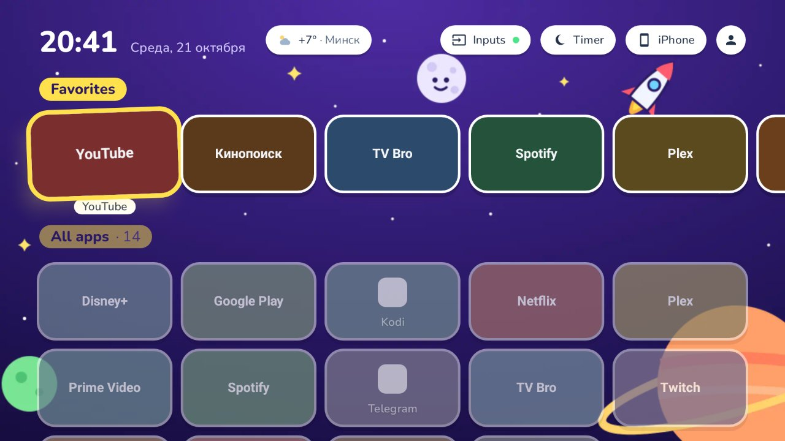
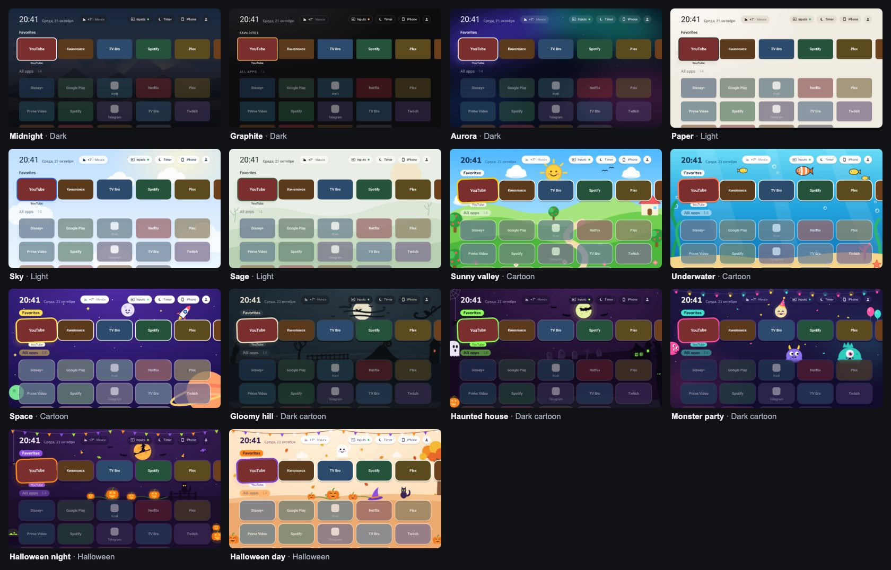

# Simple TV Launcher

A calm home screen for Android TV and Google TV. No ads, no "recommended for you" rows, no
tracking and no background services. It shows your apps and the few things you ask for: a clock,
the weather, HDMI inputs and website shortcuts, in one of fourteen themes.



It is not on Google Play. You install it with `adb` (or from a USB drive once it is running).

- Built for and tested on a **Xiaomi TV A Pro 2025 55"** (Google TV, Android 11).
- Should work on other **Android TV / Google TV devices with Android 11 (API 30) or newer**, but
  only the Xiaomi TV has been tested. Making it the default Home on Google TV needs `adb` (see below).

## Contents

- [Features](#features)
- [Themes](#themes)
- [Requirements](#requirements)
- [Install: quick start](#install-quick-start)
- [1. Get the APK](#1-get-the-apk)
- [2. Prepare the TV](#2-prepare-the-tv)
- [3. Install the launcher](#3-install-the-launcher)
- [4. Grant permissions](#4-grant-permissions)
- [5. Make it the default Home screen](#5-make-it-the-default-home-screen)
- [6. Optional extras](#6-optional-extras)
- [7. Update](#7-update)
- [Troubleshooting](#troubleshooting)
- [Development](#development)
- [Privacy](#privacy)
- [License](#license)

## Features

**Home screen**
- Clock and date, a weather chip, and a top bar with **Inputs**, **Timer**, **iPhone** and a round
  profile button that opens Settings.
- **Favorites** row in your own order, and an **All apps** grid (5 per row) sorted by how often you
  open each app. Apps without a TV banner get a generated one (icon + name).
- **Long-press OK** on a tile: Add to / Remove from favorites, Move, Hide, App info, Uninstall.
- **Hidden** section at the bottom of Home (collapsed), and a Hidden apps page in Settings.
- **Website shortcuts:** tiles that open a web address in a browser (TV Bro is recommended).
- The section without focus fades, so you always see where you are. Back, Home and turning the TV
  on bring focus back to the first favorite.

**TV controls**
- **Inputs:** one button with a popup that lists every HDMI input and whether something is
  connected; OK switches to it. A green dot shows when any input has a device.
- **HDMI signal prompt:** when a device on an HDMI input turns on, a small card asks
  "Signal on HDMI 2 — Switch / Not now" (also over other apps, with a permission).
- **Turn off TV** (Settings) and a **sleep timer** (Timer chip), through a small accessibility helper
  you enable once over `adb`.
- **Settings tiles** for Wi-Fi, Bluetooth, Sound, Picture, Sleep timer and the Android settings
  (tiles the TV can't open are hidden).

**Weather**
- Current weather in the top bar and a panel with "feels like", wind, the next hours and 5 days.
- City detected by IP or chosen by hand. Data from [Open-Meteo](https://open-meteo.com). It is
  fetched only while the home screen is visible.

**Personalisation**
- **14 themes** in five families with live preview, plus an optional **day / night schedule**
  (one theme by day, another after sunset).
- **Background:** the theme's art, one of six colours, or a picture from a USB drive.
- **Profile photo** for the Settings button (a picture from USB).
- **Languages:** Belarusian, Russian, English, Polish, German, French, or "Same as the TV".

**Other**
- **Install from USB:** finds `.apk` files on a USB drive and installs or updates them (including the
  launcher itself) through the system installer.
- **iPhone button:** opens [AirPlay Server](https://github.com/jqssun/android-airplay-server) for
  iPhone screen mirroring, and explains how to install it if it is missing.
- **Safe mode:** if the launcher crashes twice within 10 minutes, it starts with the default theme and
  only your apps and Settings, so the TV never ends up on a black screen.

## Themes



| # | Theme | Family | Look | Focus colour |
|---|---|---|---|---|
| 1 | Midnight (default) | Dark | Nature art under a dark scrim | white |
| 2 | Graphite | Dark | Near-black gradient, minimal, uppercase titles | amber |
| 3 | Aurora | Dark | Soft northern lights, glowing focus | white + violet glow |
| 4 | Paper | Light | Warm off-white, soft shadows | dark ink |
| 5 | Sky | Light | Blue sky with clouds | blue |
| 6 | Sage | Light | Calm green hills | green |
| 7 | Sunny valley | Cartoon | Hills, a little house, a smiling sun | yellow |
| 8 | Underwater | Cartoon | Fish, bubbles, seaweed | coral |
| 9 | Space | Cartoon | Rocket, smiling moon, ringed planet | yellow glow |
| 10 | Gloomy hill | Dark cartoon | Huge moon striped by clouds, ravens, spiral hill, twisted trees | pale moonlight |
| 11 | Haunted house | Dark cartoon | Sickly moon with bats, crooked house, graveyard, ghost, spider | toxic green |
| 12 | Monster party | Dark cartoon | Violet night, party lights, a moon in a party hat, monsters peeking over the apps | pink |
| 13 | Halloween night | Halloween | Orange moon with a witch, glowing pumpkins, a black cat on a fence | orange |
| 14 | Halloween day | Halloween | Autumn sky, falling leaves, a friendly ghost, smiling pumpkins | violet |

Cartoon themes use the rounded [Nunito](https://fonts.google.com/specimen/Nunito) font, "sticker"
cards and a playful tilted focus. Change the theme in **Settings → Theme**: focusing a thumbnail
previews it, OK saves it, Back cancels. **Change by time of day** picks a daytime theme and an
evening theme (for example Halloween day and Halloween night) and switches at sunset and sunrise.

## Requirements

- An **Android TV or Google TV with Android 11+**, on the same network as your computer.
- A computer with **`adb`** (Android platform-tools).
- To build from source: **JDK 17+** (21 recommended) and the **Android SDK** (platform 37,
  build-tools 36). The Gradle wrapper downloads Gradle itself.

## Install: quick start

The whole path from a fresh clone to the launcher on your TV. `TV_IP` is your TV's address
(Settings → Network & Internet on the TV). Each step is explained in the sections below.

```bash
git clone https://github.com/MarozauArtsiom/simple-tv-launcher.git
cd simple-tv-launcher
./gradlew :app:assembleDebug                      # needs JDK + Android SDK, see "1. Get the APK"

adb connect TV_IP:5555                            # accept the prompt on the TV ("Always allow")
adb install -r app/build/outputs/apk/debug/app-debug.apk

PKG=io.github.marozauartsiom.tvlauncher.debug
adb shell appops set $PKG SYSTEM_ALERT_WINDOW allow
adb shell appops set --uid $PKG MANAGE_EXTERNAL_STORAGE allow
adb shell appops set --uid $PKG REQUEST_INSTALL_PACKAGES allow
adb shell appops set $PKG SCHEDULE_EXACT_ALARM allow

# Make it the Home screen (method 2 below; read its side effects first)
adb shell pm disable-user --user 0 com.google.android.apps.tv.launcherx
adb shell pm disable-user --user 0 com.google.android.tungsten.setupwraith
adb shell input keyevent KEYCODE_HOME
```

## 1. Get the APK

### Option A: download a ready APK

Every push builds the app in GitHub Actions. Open the repository's **Actions** tab, pick the latest
green **Android** run and download the **`debug-apk`** artifact (needs a GitHub account), then unzip
`app-debug.apk`.

### Option B: build it yourself

**macOS (Homebrew):**

```bash
brew install openjdk@21
brew install --cask android-commandlinetools android-platform-tools
export JAVA_HOME="$(brew --prefix openjdk@21)"
export ANDROID_SDK_ROOT="$HOME/android-sdk"
yes | sdkmanager --sdk_root="$ANDROID_SDK_ROOT" --licenses
sdkmanager --sdk_root="$ANDROID_SDK_ROOT" "platforms;android-37.0" "build-tools;36.0.0" "platform-tools"

git clone https://github.com/MarozauArtsiom/simple-tv-launcher.git
cd simple-tv-launcher
echo "sdk.dir=$ANDROID_SDK_ROOT" > local.properties
./gradlew :app:assembleDebug
```

**Linux (Debian / Ubuntu):**

```bash
sudo apt install openjdk-21-jdk adb unzip curl git
git clone https://github.com/MarozauArtsiom/simple-tv-launcher.git
cd simple-tv-launcher
scripts/setup-android-sdk.sh      # SDK into ~/android-sdk and writes local.properties
./gradlew :app:assembleDebug
```

The APK is `app/build/outputs/apk/debug/app-debug.apk`. Its package is
`io.github.marozauartsiom.tvlauncher.debug`. Every debug build (local and CI) is signed with the
same throwaway key (`app/debug.keystore`, password `android`), so a newer APK installs over an older
one and keeps your settings.

> A release build (`./gradlew :app:assembleRelease`, about 3 MB, minified with R8) needs your own
> signing key; none is kept in the repository.

## 2. Prepare the TV

1. **Settings → System → About → Android TV OS build:** press OK seven times until it says you are
   a developer.
2. **Settings → System → Developer options:** turn on **USB debugging**. If the TV has
   **Wireless debugging** or **Network debugging**, turn it on too.
3. Find the TV's IP address in **Settings → Network & Internet**.

## 3. Install the launcher

```bash
adb connect TV_IP:5555
# With "Wireless debugging" (pairing code on the TV screen) use instead:
#   adb pair TV_IP:PAIRING_PORT PAIRING_CODE && adb connect TV_IP:PORT
adb devices                        # the TV must be listed as "device", not "unauthorized"
adb install -r app-debug.apk       # or app/build/outputs/apk/debug/app-debug.apk
```

Accept the debugging prompt on the TV and tick **Always allow**. The launcher now appears in the TV's
app list like any other app; open it from there to try it before making it the Home screen.

## 4. Grant permissions

The launcher asks only for what its features need. These are granted once over `adb`; if one is
missing, the feature's page shows the exact command and a **Check again** button.

```bash
PKG=io.github.marozauartsiom.tvlauncher.debug
adb shell appops set $PKG SYSTEM_ALERT_WINDOW allow                 # HDMI prompt over other apps
adb shell appops set --uid $PKG MANAGE_EXTERNAL_STORAGE allow       # read USB drives (pictures, .apk)
adb shell appops set --uid $PKG REQUEST_INSTALL_PACKAGES allow      # install apps from USB
adb shell appops set $PKG SCHEDULE_EXACT_ALARM allow                # sleep timer fires on time
```

**Turn off TV and sleep timer.** An ordinary app can't power the TV off, so the launcher ships a tiny
accessibility helper. It reads nothing, receives no events and acts only when you press "Turn off TV"
or the timer ends: it opens the system power menu and presses "Power off". Enable it once (this adds
it to the services already enabled and turns none off):

```bash
adb shell 'svc=io.github.marozauartsiom.tvlauncher.debug/io.github.marozauartsiom.tvlauncher.system.power.PowerService; cur=$(settings get secure enabled_accessibility_services); case "$cur" in null|"") new=$svc;; *"$svc"*) new=$cur;; *) new="$cur:$svc";; esac; settings put secure enabled_accessibility_services "$new"; settings put secure accessibility_enabled 1'
adb shell settings get secure enabled_accessibility_services      # must list ...PowerService
```

If your TV names the power-off item differently, the menu just stays open; please open an issue with
the item's name. Turn the helper off in Settings → Accessibility, or with
`adb shell settings put secure enabled_accessibility_services null` (this clears all services).

## 5. Make it the default Home screen

Google TV usually hides the "default Home app" choice, so the Home button keeps opening the stock
launcher. Try the methods in order and keep the first one that still works **after a reboot**.

Write down the current state first:

```bash
adb shell cmd package query-activities --brief -a android.intent.action.MAIN -c android.intent.category.HOME
adb shell dumpsys role | grep -A1 'name=android.app.role.HOME'
```

**Method 1: give it the HOME role (harmless).**

```bash
adb shell cmd role add-role-holder --user 0 android.app.role.HOME io.github.marozauartsiom.tvlauncher.debug
adb shell input keyevent KEYCODE_HOME
```

Press Home, reboot, press Home again. Many Google TV builds ignore the role (the Xiaomi TV A Pro 2025
does); then use method 2. Undo:
`adb shell cmd role add-role-holder --user 0 android.app.role.HOME com.google.android.apps.tv.launcherx`

**Method 2: disable the stock launcher (works almost everywhere, has side effects).**

```bash
adb shell pm disable-user --user 0 com.google.android.apps.tv.launcherx
adb shell pm disable-user --user 0 com.google.android.tungsten.setupwraith   # setup fallback that re-enables it
adb shell input keyevent KEYCODE_HOME
```

Side effects: Google TV's own tabs, profiles and recommendations are gone; some remote buttons that
go through the stock launcher (for example YouTube) may stop working; a system update may turn the
stock launcher back on. Undo:

```bash
adb shell pm enable com.google.android.apps.tv.launcherx
adb shell pm enable com.google.android.tungsten.setupwraith
```

> **Black screen?** If the launcher crashes while the stock one is disabled, the TV shows a black
> screen. Connect with `adb` and run the undo commands above. After two crashes within 10 minutes the
> launcher starts in safe mode by itself.

## 6. Optional extras

- **TV Bro** (web browser for TVs, [github.com/truefedex/tv-bro](https://github.com/truefedex/tv-bro),
  Releases): website shortcuts open in it. `adb install tv-bro.apk`
- **AirPlay Server** (`io.github.jqssun.airplay`,
  [github.com/jqssun/android-airplay-server](https://github.com/jqssun/android-airplay-server), Releases):
  iPhone screen mirroring; the **iPhone** button opens it. Download `app-release.apk`, then:

  ```bash
  adb install -r app-release.apk
  adb shell appops set io.github.jqssun.airplay SYSTEM_ALERT_WINDOW allow   # lets mirroring pop up over Home
  ```

  Open it once on the TV; it keeps running in the background and starts at boot. On the iPhone:
  Control Center → Screen Mirroring → "Android AirPlay".
- Keyboard: the system one (Gboard). Screensaver: Google's Ambient mode. Neither is built into the
  launcher.

Both apps can also be put on a USB drive and installed with **Settings → Install from USB**.

## 7. Update

Get a newer `app-debug.apk` and run `adb install -r app-debug.apk`, or put it on a USB drive and use
**Settings → Install from USB** (the file shows **Update**). Settings, favorites and permissions stay.

## Troubleshooting

| Problem | Fix |
|---|---|
| `adb devices` shows `unauthorized` | Accept the prompt on the TV screen (tick "Always allow"), then `adb connect` again |
| `adb connect` times out | Debugging is off or the TV changed its IP; check steps in "2. Prepare the TV" |
| Home still opens the stock launcher | Use method 2 in "5. Make it the default Home screen" |
| Black screen after Home | Run the method 2 undo commands |
| A page asks you to run a command | Run it on your computer (section 4) and press **Check again** |
| No weather | It needs internet; pick the city by hand in **Settings → Weather** |
| The HDMI card doesn't appear over apps | Grant `SYSTEM_ALERT_WINDOW` (section 4) |
| "Turn off TV" asks for a helper | Enable the accessibility helper (section 4) |
| Safe mode note on Home | The launcher crashed twice in a row; it clears itself after 10 minutes. Please open an issue |

How to open Settings: the **Menu** key on the remote, or Up from the first row and Right to the round
profile button in the top-right corner.

## Development

**Stack:** Kotlin, Jetpack Compose with `androidx.tv:tv-material`, one activity, DataStore, manual
DI. No ad, analytics or tracking SDKs. Versions and architecture: [`docs/tech-stack.md`](docs/tech-stack.md).

```bash
./gradlew :app:assembleDebug                 # build
./gradlew :app:testDebugUnitTest             # unit + Robolectric UI tests
./gradlew :app:verifyRoborazziDebug          # screenshot tests against app/src/test/snapshots
./gradlew :app:recordRoborazziDebug          # re-record screenshots after an intended UI change
./gradlew :app:assembleRelease               # R8 release build (needs your signing key)
adb install -r app/build/outputs/apk/debug/app-debug.apk
```

CI (GitHub Actions, `.github/workflows/android.yml`) runs the build, all tests and the screenshot
check on every push and uploads the debug APK.

| Path | What it holds |
|---|---|
| `app/src/main/kotlin/…/tvlauncher/` | The app: `ui/` (home, settings, theme, weather…), `data/`, `system/` |
| `app/src/main/res/values*/strings.xml` | UI strings in six languages (English is the fallback) |
| `app/src/test/` | Unit, Robolectric and Roborazzi screenshot tests; goldens in `snapshots/` |
| `design/mockups/` | HTML mockups (Russian UI), theme tokens in `themes.css`, background art in `assets/bg/` |
| `docs/requirements.md` | Requirements and decisions |
| `docs/ui-spec.md` | Every screen and component, the theme table and tokens |
| `docs/tech-stack.md` | Versions, libraries, architecture, testing, CI |
| `docs/sow.md`, `docs/tasks.md`, `docs/progress.md` | Scope, ordered tasks with the on-TV checklist, and the work log |
| `CLAUDE.md`, `.claude/skills/` | Instructions and skills for AI coding agents working on this repo |

**Adding a theme:** draw the background as an SVG in `design/mockups/assets/bg/`, add the tokens to
`design/mockups/themes.css`, preview it with
`node .claude/skills/tv-ui-design/scripts/render-mockup.cjs "design/mockups/home.html?t=<id>"`
(needs Playwright), then port it to `ui/theme/Themes.kt` (`ThemeCssSyncTest` checks they match),
add `bg_<id>.webp` and `thumb_<id>.webp` to `res/drawable-nodpi`, the name in all six
`strings.xml`, and record the screenshots.

## Privacy

- No ads, no analytics, no tracking, no accounts.
- Network access is used only for the weather: [Open-Meteo](https://open-meteo.com) for the forecast
  and city search, and an IP geolocation lookup ([ipinfo.io](https://ipinfo.io), falling back to
  [ipapi.co](https://ipapi.co)) when the city is set to automatic. It runs only while the home screen
  is visible.
- Nothing runs in the background. The exceptions are ones you turn on yourself: the power-off helper
  (receives no events) and a single alarm while a sleep timer is set.

## License

[MIT](LICENSE) © Artsiom Marozau.

Third-party parts keep their own licenses: the Nunito font is under the
[SIL Open Font License 1.1](app/src/main/assets/licenses/OFL-Nunito.txt); weather data is provided by
[Open-Meteo.com](https://open-meteo.com) under CC BY 4.0; the Google skills in `.claude/skills/` are
under Apache 2.0 (see each `LICENSE.txt`). This project is not affiliated with Google or Xiaomi.
